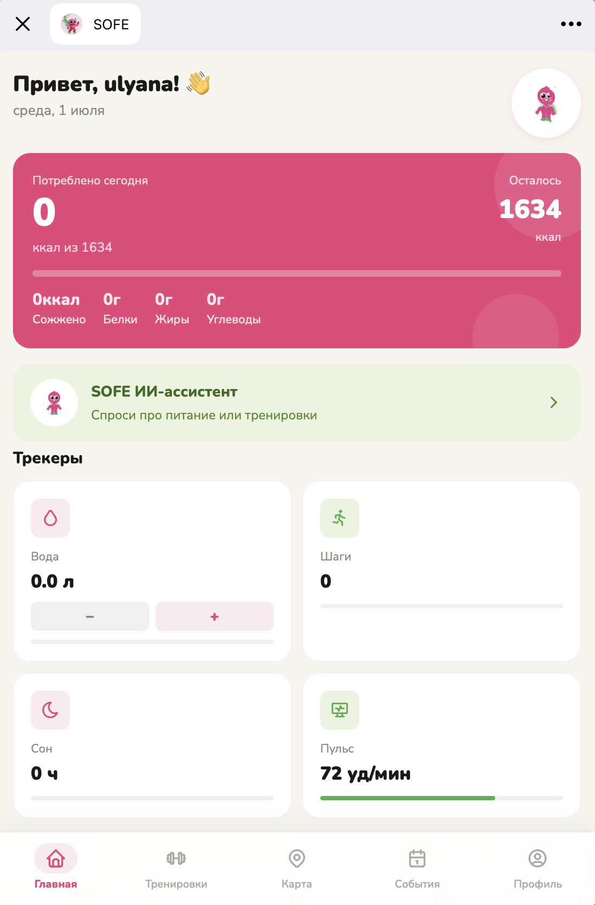
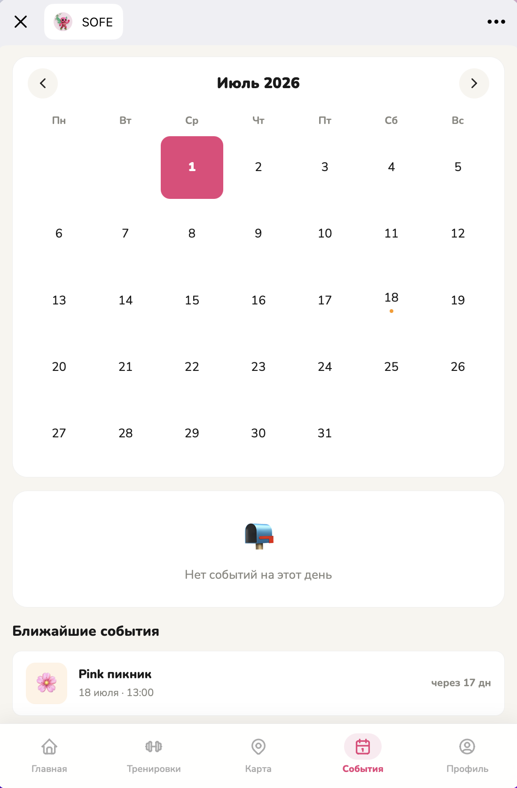
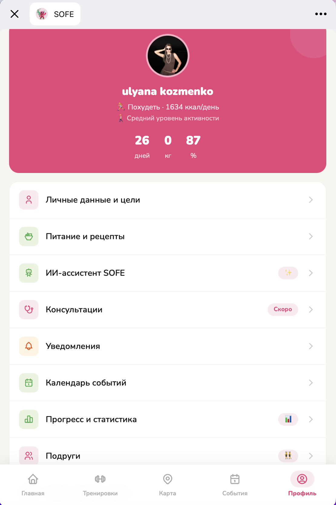
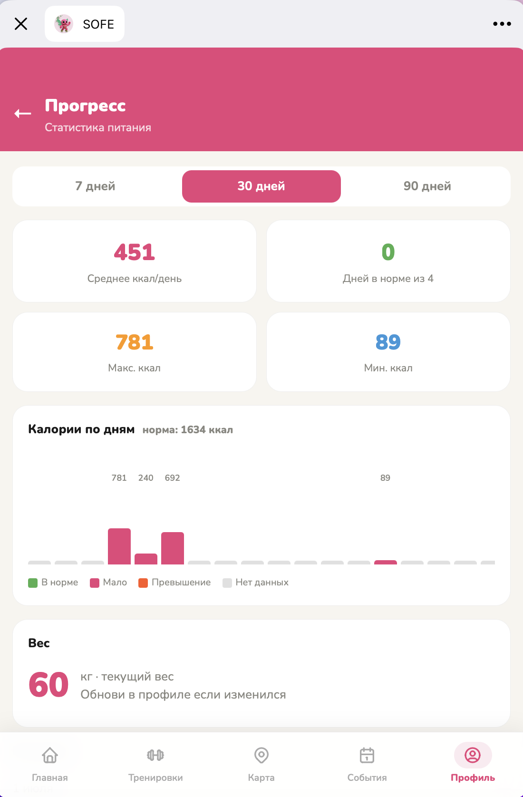
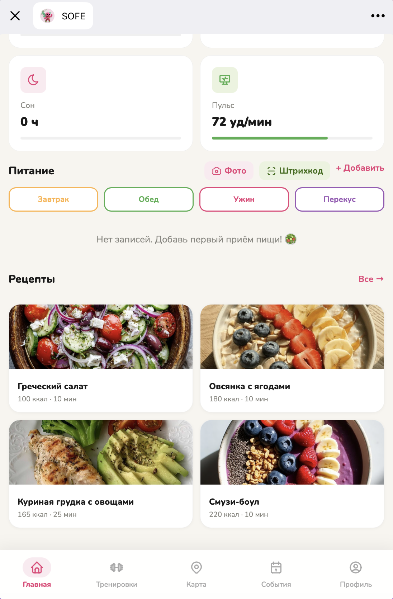
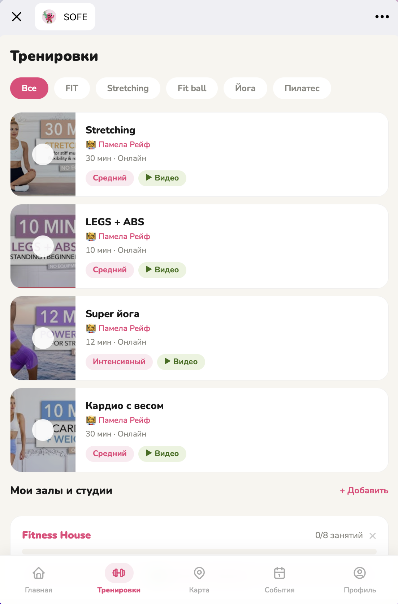
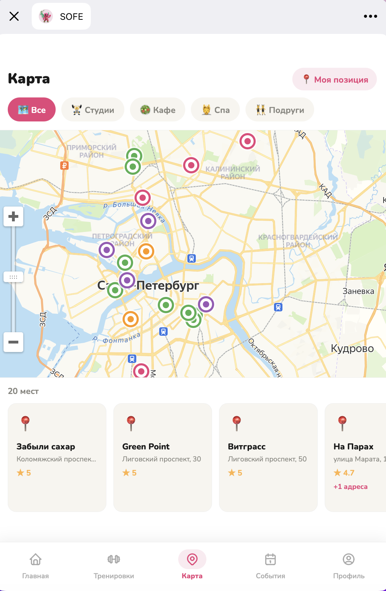
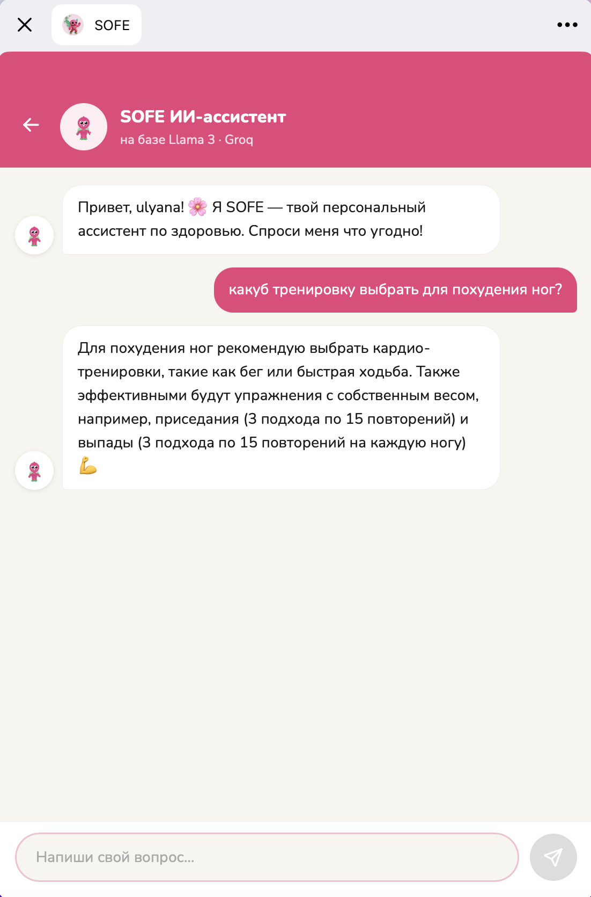

# Sofe — Wellness Telegram Mini App

Sofe — Telegram Mini App для комплексного управления привычками, питанием, тренировками и повседневной wellness-активностью.

Проект создавался как единая точка входа для пользователя, который хочет следить за здоровым образом жизни без необходимости использовать несколько отдельных приложений.

Sofe объединяет продуктовую концепцию, UX/UI, frontend, backend, Telegram-бота, социальные функции и персональные wellness-инструменты.

## Интерфейс приложения

<p align="center">
  
  
  
</p>

<p align="center">
  
  
  
</p>

<p align="center">
  
  
</p>

## Идея продукта

Большинство wellness-сервисов решают только одну задачу:

- подсчёт питания;
- тренировки;
- привычки;
- отслеживание прогресса;
- поиск спортивных и wellness-мест;
- социальная мотивация.

Идея Sofe — объединить эти сценарии в одном продукте и сделать их доступными непосредственно внутри Telegram.

Основной фокус продукта:

- минимальный порог входа;
- ежедневное использование;
- персонализация;
- объединение разных wellness-сценариев;
- социальная мотивация;
- удобство Telegram Mini App.

## Целевая аудитория

Основная аудитория продукта — пользователи, которые хотят поддерживать здоровый образ жизни и системно работать с привычками, питанием и активностью.

Ключевые потребности:

- видеть общую картину своего прогресса;
- учитывать питание;
- фиксировать тренировки;
- получать рекомендации;
- не переключаться между большим количеством приложений;
- сохранять мотивацию;
- взаимодействовать с друзьями;
- находить подходящие wellness-активности и места.

## Основные функции

### Главный экран

Главный экран объединяет основные показатели и быстрый доступ к ключевым функциям приложения.

Пользователь может видеть актуальную информацию о своей активности и переходить к нужным разделам без сложной навигации.


### Календарь

Календарь объединяет пользовательские активности во временной структуре.

Он позволяет планировать и отслеживать wellness-события и видеть их как часть регулярного образа жизни.


### Профиль

В профиле собрана персональная информация пользователя и данные, связанные с использованием приложения.


### Прогресс

Раздел Progress позволяет отслеживать изменения пользовательских показателей и видеть динамику во времени.

Идея функции — дать пользователю не только возможность фиксировать действия, но и видеть накопленный результат.


### Питание и рецепты

В приложении реализованы сценарии для работы с питанием.

Пользователь может:

- учитывать продукты;
- работать с данными о питании;
- использовать базу продуктов;
- просматривать рецепты;
- связывать питание с другими wellness-показателями.


### Тренировки

В Sofe есть отдельный раздел для тренировок.

Пользователь может:

- записывать тренировки;
- хранить историю активности;
- отслеживать тренировочный процесс;
- использовать данные тренировок вместе с другими показателями приложения.


### Карта

Карта является частью wellness-экосистемы Sofe.

Она позволяет объединить цифровой продукт с реальной городской инфраструктурой и помогает пользователю находить связанные со спортом, активностью и здоровым образом жизни места.


### AI Assistant

В приложении реализован отдельный AI Assistant.

AI-функциональность встроена в пользовательский сценарий и используется как дополнительный инструмент взаимодействия с wellness-данными и рекомендациями.


## Социальные функции

Sofe включает социальный слой продукта.

В приложении реализована логика взаимодействия с друзьями, которая может использовать окружение пользователя как дополнительный источник мотивации.

Социальные механики позволяют развивать продукт не только как персональный wellness-трекер, но и как платформу для совместной активности.

## Уведомления

В backend реализована отдельная система уведомлений.

Она позволяет поддерживать регулярное взаимодействие пользователя с продуктом и возвращать его к запланированным действиям.

## Telegram Mini App

Sofe работает в формате Telegram Mini App.

Такой формат был выбран, чтобы:

- не требовать установки отдельного приложения;
- снизить барьер первого использования;
- использовать существующую Telegram-аудиторию;
- объединить Mini App и Telegram-бота;
- использовать Telegram как канал уведомлений и возвращения пользователей.

## Архитектура проекта

Проект разделён на frontend и backend.

```text
sofe/
├── frontend/
├── backend/
├── docs/
├── images/
└── README.md
```

## Frontend

Frontend реализован на React.

Основные технологии:

- React;
- Vite;
- React Router;
- Telegram Web App SDK;
- Axios.

Структура frontend включает отдельные страницы для основных продуктовых сценариев:

```text
frontend/src/pages/
├── AIAssistant.jsx
├── Calendar.jsx
├── FoodScan.jsx
├── Friends.jsx
├── Home.jsx
├── MapScreen.jsx
├── Notifications.jsx
├── Nutrition.jsx
├── Onboarding.jsx
├── Profile.jsx
├── Progress.jsx
└── Workouts.jsx
```

Такое разделение позволяет развивать каждую продуктовую функцию независимо.

## Backend

Backend построен на Node.js и Express.

Используются:

- Express;
- Telegram Bot API;
- node-cron;
- Turso / libSQL;
- REST API;
- environment variables;
- отдельные routes для продуктовых модулей.

Backend разделён по функциональным областям:

```text
backend/routes/
├── admin.js
├── ai.js
├── foods.js
├── friends.js
├── misc.js
├── nutrition.js
├── user.js
└── workouts.js
```

Отдельно реализованы:

- Telegram bot;
- система уведомлений;
- работа с базой данных;
- пользовательские данные;
- питание;
- тренировки;
- друзья;
- AI-функции.

## База данных

В проекте используется libSQL / Turso.

В базе хранятся данные, необходимые для работы пользовательских сценариев, включая данные о питании и других сущностях продукта.

Также в проекте есть seed-данные для продуктов и рецептов.

## Продуктовый подход

Sofe создавался не только как технический проект.

Работа над продуктом включала:

- поиск идеи;
- определение пользовательской проблемы;
- формирование продуктовой концепции;
- проектирование структуры приложения;
- разработку пользовательских сценариев;
- UX/UI;
- разработку frontend;
- разработку backend;
- интеграцию Telegram;
- развитие функциональности;
- анализ дальнейшей модели развития продукта.

## Моя роль

Sofe — собственный проект, в котором я работала сразу в нескольких ролях:

- Product Manager;
- Product Designer;
- разработчик;
- аналитик;
- автор продуктовой концепции.

Я отвечала за путь от идеи до работающего продукта:

1. формирование концепции;
2. определение структуры продукта;
3. проектирование функций;
4. UX/UI;
5. техническую реализацию;
6. развитие продукта;
7. поиск дальнейших направлений роста.

## Что показывает проект

Sofe демонстрирует полный цикл создания цифрового продукта:

- поиск пользовательской проблемы;
- формирование product vision;
- создание MVP;
- проектирование пользовательских сценариев;
- UX/UI;
- frontend-разработка;
- backend-разработка;
- Telegram-интеграция;
- работа с базой данных;
- AI-функциональность;
- социальные механики;
- развитие продукта после MVP.

Главная ценность кейса — не отдельная техническая функция, а способность собрать продукт целиком: от идеи и логики пользовательского опыта до работающей реализации.

## Стек

### Frontend

`React` · `Vite` · `React Router` · `Axios` · `Telegram Web App SDK`

### Backend

`Node.js` · `Express` · `Telegram Bot API` · `node-cron`

### Data

`Turso` · `libSQL`

### Product

`Product Strategy` · `MVP` · `UX/UI` · `User Flows` · `Product Development`

## Структура проекта

```text
sofe/
├── frontend/
│   ├── src/
│   │   ├── components/
│   │   ├── hooks/
│   │   ├── pages/
│   │   ├── styles/
│   │   └── utils/
│   └── package.json
│
├── backend/
│   ├── db/
│   ├── middleware/
│   ├── routes/
│   ├── bot.js
│   ├── notifications.js
│   ├── index.js
│   └── package.json
│
├── docs/
├── images/
│   ├── AI-bot.png
│   ├── calendar.png
│   ├── main.png
│   ├── map.png
│   ├── profile.png
│   ├── progress.png
│   ├── recipes.png
│   └── trainings.png
│
└── README.md
```

## Статус проекта

Рабочий Telegram Mini App с реализованными основными пользовательскими сценариями и backend-логикой.

Проект продолжает развиваться как самостоятельный продуктовый кейс и площадка для тестирования новых wellness-, social- и AI-механик.
